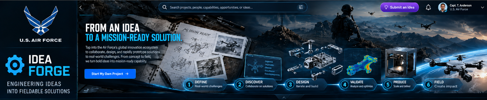

# Idea Forge

Turning bold ideas into mission-ready capabilities. One Databricks app: AppKit is the runtime, the Unified Mission Workbench (UMW) provides the underlying capabilities, and the concept graphic is the UI contract. The Lakebase schema stays `foundry` so existing review-trail tables do not move. GitHub redirects the old `cl-idea-foundry` and `cl-idea-forge` URLs to this repository.



Planning docs — product requirements, technical requirements, app flow, design brief, backend schema and implementation plan — are in [`docs/`](docs/README.md).

## What is in this first slice

- **Shell** from the concept: Air Force lockup and Idea Forge mark in the sidebar, search, notifications and the signed-in user in the top bar.
- **UMW identity cluster**: Ask your Wingman, Air Force / Army / Navy switch, welcome and last logon, and the decisions bell. Concept persona is Gen. John Duselis, AFLCMC / RSO, until a real sign-in arrives. Wingman answers are local, same as the UMW first slice.
- **Hero** with the headline, Start My Own Project, and the six-stage pipeline: Define, Discover, Design, Validate, Produce, Field.
- **Collapse tab.** The tab under the hero folds it vertically into a single band that keeps the headline, the call to action and the pipeline. The choice is remembered per browser. Below 1720 px wide the band shows the pipeline only.
- **Menu**: Home, Community, and My Work. Challenges and Capabilities are dropped. Home is projects in flight. Community is people and shared work. My Work is the signed-in owner's queue.
- **Stage pages** for each of the six stages. Design and Validate open UMW's CAD workspace; Produce opens the slicer (below); Define, Discover and Field list the projects at that stage and are marked as concept.
- **Start My Own Project** adds a project at Define.

Data is the design mock (`client/src/lib/data.ts`). When a slice moves to the warehouse, its query goes in `config/queries/`.

## Capabilities from UMW

Copied from `DocBranton/umw` at `8bf07e0`, not imported. Changes are limited to renaming.

| Capability | Where | Notes |
| --- | --- | --- |
| AppKit runtime, build and bundle config | `package.json`, `tsconfig*.json`, `tsdown.server.config.ts`, `client/vite.config.ts`, `app.yaml`, `databricks.yml` | App name `idea-forge`, same workspace as UMW |
| Verified Engineering CAD | `client/src/cad/`, `client/public/cad/`, `client/public/vendor/occt/` | STEP, IGES, BREP, STL, OBJ, glTF in the browser. Feature recognition, drawing generation. OpenCascade is LGPL-2.1, unmodified |
| CAD review trail | `server/cad-events.ts`, `server/cad-routes.ts` | Lakebase table renamed to `foundry.cad_events`. Off until a `postgres` resource is configured (see UMW's README › Review trail; the steps are the same) |
| Signed-in user | `server/me-route.ts` | `GET /api/me` from the Databricks Apps headers. The top bar shows the concept persona until a real user is signed in |

The stage pages use the CAD workspace in its stand-alone mode, so reviews are kept in the browser. Wiring it to the shared review trail, as UMW's Engineering view does, is the next step for Validate.

## Slicer (Produce stage)

Produce slices the part last opened in Design or Validate (or one opened on the page) for a 3D printer. The layout follows OrcaSlicer: Prepare and Preview tabs, one settings sidebar (printer, filament, objects, process), a line-type legend with time per feature, and layer and move sliders. The code and icons are Idea Forge's own.

Slicing is done by [Kiri:Moto](https://github.com/GridSpace/grid-apps) (MIT) in the browser, in web workers. Parts never leave the browser and nothing is needed on the server, so it runs as-is in the Databricks app. Code: `client/src/slicer/` (screen, Kiri runner, G-code reader, three.js preview, printer profiles).

**Kiri:Moto engine.** `client/public/vendor/kiri/` is built from the grid-apps commit in `scripts/kiri.lock`. To update it, change that line and push to a branch: the **Vendor Kiri:Moto engine** workflow rebuilds the bundle, slices a test cube with it in headless Chromium, and commits the result and a G-code fixture (`client/src/slicer/fixtures/kiri-cube.gcode`) to the branch. Kiri fetches its geometry wasm from `/wasm/`, so that file is also in `client/public/wasm/`. The six printer profiles in `client/src/slicer/kiri-devices.json` are Kiri's own, unchanged.

**Tests.** `npm run test:slicer` covers the G-code reader against the real Kiri fixture, the STL export and the profile mapping. The **Slicer e2e** workflow builds the client and, in headless Chromium, slices the sample part with Kiri, checks the preview, and downloads the G-code.

## Screen sizes

Built for wide-screen monitors. The smallest supported screen is a 1366×768 laptop, which the Slicer e2e checks. Production is never accessed from a phone. See `CLAUDE.md` for the design notes.

## Run

Requires the Databricks CLI, authenticated to the workspace in `databricks.yml`.

```bash
npm install
npm run dev
```

```bash
npm run typecheck
npm run build
npm run test:cad
npm run test:slicer
npm run test:server
```

## Deploy

`databricks bundle deploy` from this directory, or run the **Deploy Idea Forge to Databricks** workflow. The workflow is manual until the `DATABRICKS_TOKEN` secret is added to this repository; then add a `push` trigger on `main`.

## Hero art

`client/public/brand/hero-art.jpg` is cropped from the concept image and upscaled. Replace it with the full-resolution art at the same aspect (about 4.8:1); the stylesheet anchors it to the right and fades it into the headline on the left.
